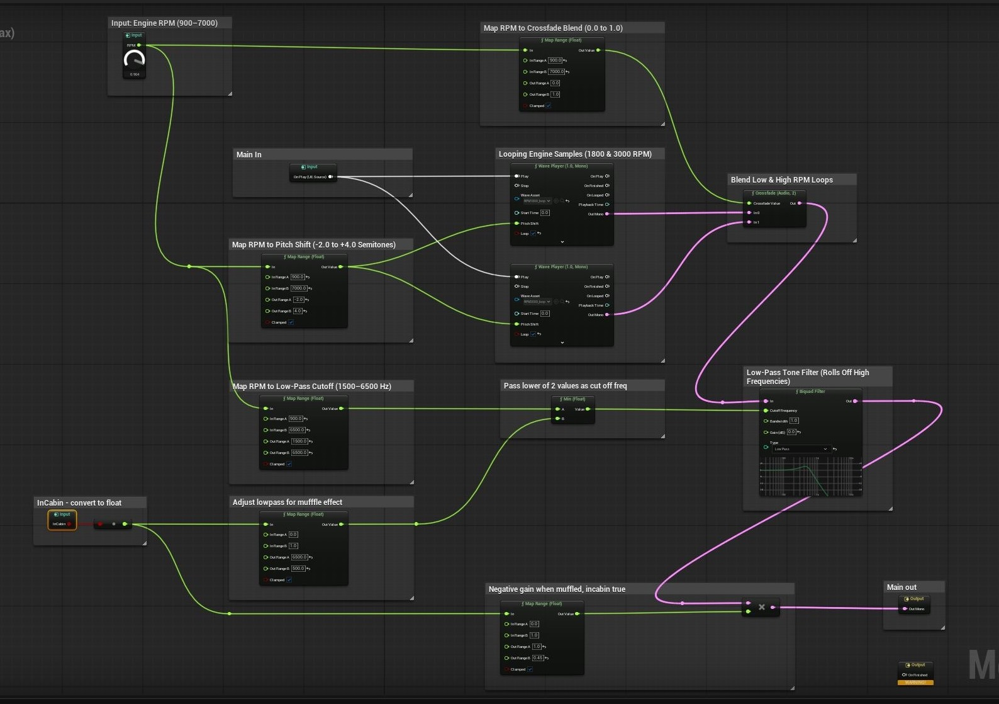

# Project Name  Radio Stream Test - GAME3000 Fall '26

## Description

A github repository demonstrating an RPM controlled Metasound for a car engine in Unreal Engine.    

## UPDATE
In process / files
 
## Usage
Clone, or download the zip, to a local directory. Open in Unreal Engine 5.5 or newer

## Attributions
1. Forester engine sounds, S Benoit GameDevAssets, https://github.com/sbenoit-gc/GameDevAssets

